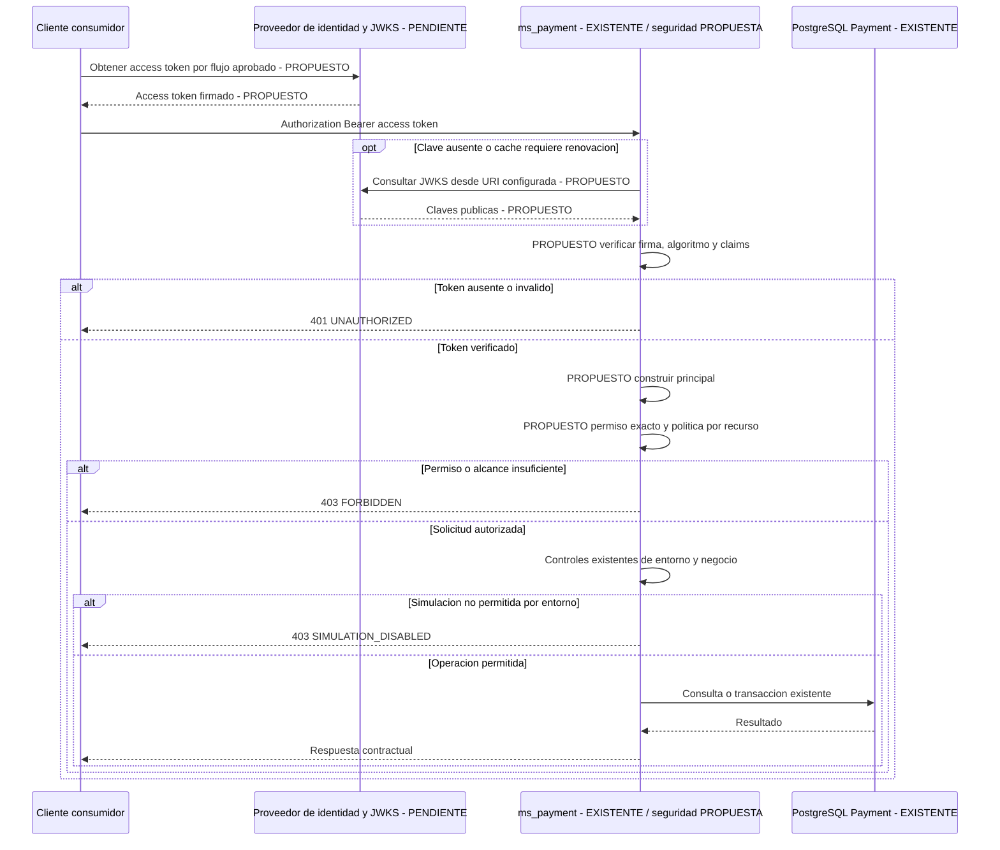

# Fase 2.7 — Diseño de autenticación y autorización para ms_payment

Fecha: 2026-10-27, America/Guayaquil. **Diseño para revisión, no aprobado ni implementado.** Esta fase solo crea este documento y verifica la regresión. No cambia código, contratos, SQL, dependencias ni variables de entorno.

## 1. Resumen ejecutivo

Payment debe ser un **resource server**: verificar access tokens de un emisor autorizado y comprobar permisos y alcance sobre el recurso. No emitirá JWT, autenticará contraseñas ni gestionará refresh tokens. Propuesta técnica pendiente: guards nativos de NestJS con `jose` para verificación criptográfica y JWKS.

El SQL oficial contempla **ms_identity**, usuarios, sesiones y roles. Es evidencia de un modelo de identidad, no de un proveedor operativo o claves disponibles. El contrato general menciona un Gateway, pero no hay implementación/configuración local para confiarle identidad. Ninguna URL de sus ejemplos se adopta como issuer o JWKS.

Dos decisiones independientes bloquean una activación segura: el perfil del emisor y la autorización por recurso. Payment persiste `ord_id`, sin propietario ni tenant, y no consulta Order. Tener `payment:read` no demuestra propiedad de un pago. Se propone denegar operaciones sobre pagos cuando no pueda determinarse un alcance confiable, también para servicios; no introducir un acceso global implícito como solución provisional.

`payment:simulate` está declarado contractualmente como propuesta, pero no se aplica. No convierte el control de entorno en autenticación. La simulación conservará sus defensas actuales y seguirá prohibida en producción incluso con token y permiso válidos.

## 2. Inspección e inventario real

Fuentes: [auditoría 2.5](auditoria-fase-2.5.md), [BigId 2.6](fase-2.6-bigid.md), [OpenAPI Payment](../contract/ms_payment-openapi-v1.yaml), [OpenAPI general](../../../../contracts/openapi/atracciones-openapi-v3.yaml), [SQL oficial](../../../infrastructure/databases/02_microservicios_v2_bases_de_datos.sql), [flujo de trabajo](../../../docs/development/flujo_trabajo.md), estructura del repositorio, módulos/controladores/servicios, filtro, validación de entorno, Compose y pruebas. Se inspeccionó configuración sin publicar credenciales. README raíz y render.yaml están vacíos. Los documentos `Plan/...` citados por el SQL no están disponibles; no se presume su contenido.

**Existente** indica evidencia local, aclarando cuando es solo documental; **Propuesto** indica una elección de este diseño; **Pendiente** indica un componente operativo o decisión no disponible. Ausencia en este checkout no demuestra ausencia en toda la organización.

| Componente | Clasificación y evidencia | Implicación |
|---|---|---|
| Payment y PostgreSQL | Existentes: src, Compose y pruebas reales | Mantener operaciones y persistencia |
| ms_auth | Pendiente: no hay código/configuración localizada | No inventar un nuevo servicio con ese nombre |
| ms_identity / usuarios | Existentes como definición SQL: usuario, rol, usuario_rol, sesion, token_verificacion; implementación/despliegue pendientes | Candidato arquitectónico, no emisor confirmado |
| ADMIN, OPERADOR, CLIENTE | Existentes como seeds SQL de Identity | No existe mapeo aprobado a permisos Payment |
| Sesión/revocación | SQL define ses_token_hash, ses_expira_en y ses_revocada | No define formato JWT ni validación distribuida |
| API Gateway | Referencia existente en servers del contrato general e inventory.proto; implementación/rutas/seguridad pendientes | No asumir que protege Payment |
| Order / propiedad | Definición SQL existente: orden.usu_id; integración operativa pendiente | No acredita relación entre JWT sub y usuario |
| Emisor/token endpoints/JWKS/claves | Pendientes: no encontrados | Bloquean configuración real |
| iss, aud, algoritmo y perfil de claims | Pendientes: no documentados para Payment | No deducir de URLs de ejemplo |
| Roles/scopes/tenant en JWT | Pendientes: sin formato aprobado | Roles SQL no son claims verificados |
| Guards/decoradores de permisos | Pendientes: sin implementación reutilizable | AuthModule y guards son propuestas |
| BearerAuth y payment:simulate | Existentes en contrato Payment, expresamente propuestos/no implementados | No implican seguridad runtime |
| Errores | ApiExceptionFilter existente; Payment Error JSON; contrato general ProblemDetails | Conservar compatibilidad del sobre Payment |
| Separación de bases | SQL/flujo: IDs lógicos, sin FK ni consultas directas entre bases | Autorizar mediante contratos, no JOIN externo |
| Seguridad del despliegue externo | Pendiente de verificación | No se contactó producción, Gateway ni IdP |

Variables actuales: DB_HOST/PORT/USERNAME/PASSWORD/DATABASE, NODE_ENV y SIMULATION_ENABLED; main.ts lee PORT. postgres.local.env contiene configuración local de PostgreSQL. No existen variables JWT_ISSUER/AUDIENCE/JWKS configuradas. Se inspeccionaron nombres y controles, sin imprimir secretos ni cambiar archivos.

## 3. Arquitectura propuesta

1. Cliente obtiene access token del proveedor autorizado, fuera de Payment. Para clientes interactivos se propone Authorization Code + PKCE; para M2M, client credentials o identidad de workload aprobada. Proveedor y flujos están pendientes, sin nuevos endpoints de login en Payment.
2. Envía un único token por `Authorization: Bearer`. No aceptar tokens por query/body ni identidades de headers auxiliares sin verificación. Limitar tamaño y rechazar credenciales ambiguas.
3. Payment obtiene la clave pública del origen configurado y verifica firma/perfil. Un decode sin verificar nunca produce identidad.
4. Construye un principal mínimo solo desde datos verificados.
5. Evalúa permiso exacto, tipo de identidad autorizado y alcance del recurso.
6. Ejecuta el controlador solo tras autorizar. Los servicios conservan validación, bloqueos de entorno y transacciones. Resolver atributos mínimos pago→ord_id puede requerir lectura interna para la política, sin devolver datos antes de autorizar.
7. PostgreSQL sigue siendo exclusivamente la base Payment. No leer bases Identity/Order ni crear FK entre servicios.

El Gateway es opcional según topología por confirmar; aunque se adopte, Payment verifica el token. Una identidad global de Gateway no sustituye la delegación del usuario: acordar alcance y procedencia verificables. Nunca confiar en X-User-Id/X-Roles enviados por clientes. El flujo de trabajo exige contratos, timeouts y ausencia de consultas directas entre bases; no autoriza inventar un Gateway operativo.

## 4. Diagrama Mermaid

Cliente es un consumidor conceptual. Payment y PostgreSQL existen; seguridad interna es propuesta; proveedor/JWKS están pendientes. Diagrama local, sin crear infraestructura ni archivos externos.



Si faltan claves o una decisión de políticas confiable por indisponibilidad, no se permite acceso. El503 propuesto para esa dependencia requiere aprobación, como se detalla abajo.

## 5. Especificación JWT propuesta

Imprescindible para la solución futura: verificar criptografía y algoritmo permitido, emisor, audiencia, vigencia y propósito antes de usar claims. Separar access tokens de ID tokens aunque compartan firma. Se propone un issuer y un algoritmo por despliegue. Estos principios siguen las [buenas prácticas JWT RFC8725](https://www.rfc-editor.org/rfc/rfc8725.html); los parámetros locales siguientes no están aprobados.

| Elemento | Validación propuesta | Decisión pendiente |
|---|---|---|
| iss | String exacto configurado, sin normalizar slash/case | Proveedor y valor autorizado |
| aud | String/array de strings con coincidencia exacta de audiencia aprobada | Audiencia específica; sin valor inventado ni fallback genérico |
| sub | String opaco no vacío; identidad por par iss/sub | Relación con usuario; no asumir correo, usu_id o BigId |
| exp | NumericDate finito obligatorio, segundos; rechazar vencido con tolerancia limitada | Duración máxima |
| nbf | NumericDate finito si existe, validar inicio de vigencia | Presencia opcional a acordar |
| iat | Obligatorio en perfil recomendado; no futuro fuera de tolerancia, iat < exp | Perfil y edad máxima |
| jti | String no vacío, único por emisor/token en perfil recomendado | Uso para trazabilidad/revocación; no evita replay por sí solo |
| client_id | String no vacío identifica cliente en perfil recomendado | Registro y distinción usuario/servicio |
| typ protegido | Lista exacta at+jwt y application/at+jwt en perfil recomendado | Perfil que diferencia access tokens de ID tokens |
| scope | String separado por espacios ASCII; permisos exactos/case-sensitive | Única fuente canónica propuesta; formato alternativo requiere adaptador aprobado |
| Tenant/alcance | Solo claims confiables con semántica aprobada | No hay tenant Payment documentado; no inventarlo |
| Tipo de principal | Usuario/servicio según perfil y registro confiables | No inferir de formato de sub o roles arbitrarios |

Se recomienda acordar el [perfil OAuth JWT access token RFC9068](https://www.rfc-editor.org/rfc/rfc9068.html), que define tipo y claims de acceso. No se declara adoptado hasta confirmación del proveedor. Si usa otro perfil, documentar un adaptador con validación de propósito equivalente, no aceptar cualquier JWT firmado. No sumar indiscriminadamente scope, permissions y roles. Scope ausente/vacío produce principal sin permisos; scope de tipo inválido produce token inválido.

Firma inicial recomendada: **RS256**, si el emisor lo confirma, RSA pública al menos2048 bits. ES256/P-256 es alternativa a decidir, no un segundo algoritmo habilitado automáticamente. Configurar solo el acordado; rechazar none, HS*, firmas inválidas, claves incompatibles, headers críticos no soportados y JWE/JWT anidados no adoptados. Usar biblioteca mantenida, sin criptografía propia.

JWKS: URI HTTPS fija autorizada, certificado válido, sin credenciales en URL y sin redirecciones a destinos no aprobados. No seguir jku/x5u del token ni construir URI desde kid. Kid es selector acotado, no prueba de confianza; se propone exigirlo no vacío y seleccionar exactamente una clave pública de firma compatible. No almacenar claves privadas/emisor en Payment.

El resolvedor `jose` utiliza alg/kid y propiedades de uso de clave, caché y refresco, según [createRemoteJWKSet](https://raw.githubusercontent.com/panva/jose/main/docs/jwks/remote/functions/createRemoteJWKSet.md). Nuestra allowlist y perfil siguen siendo necesarios; no confiar en defaults como política del proyecto.

| Parámetro | Propuesta NO aprobada | Política |
|---|---|---|
| Vida máxima/edad | 300s | Validar iat, exp y exp-iat, no solo expiración |
| Clock tolerance | 30s, rango0..60 | Aplicación coherente a exp/nbf/iat, sin acumulaciones |
| JWKS timeout | 2000ms, rango100..5000 | Límite total por solicitud lógica; no reintentos infinitos |
| Caché máxima | 300000ms, rango1000..300000 | Nunca Infinity ni extender stale por fallo |
| Cooldown refresco | 30000ms, rango1000..60000 | Limitar kid desconocido y agrupar fetch concurrentes |
| Tamaños | Token8KiB; JWKS256KiB/32claves | Límites propuestos del adaptador/proxy, no defaults de jose |

Las opciones timeoutDuration, cacheMaxAge y cooldownDuration están documentadas en [RemoteJWKSetOptions](https://raw.githubusercontent.com/panva/jose/main/docs/jwks/remote/interfaces/RemoteJWKSetOptions.md). Los valores de esta tabla son propuestas propias.

JWKS inaccesible con clave conocida y caché aún vigente: verificar firma y todos los claims con esa clave, sin ampliar caché. Sin clave confiable o con caché vencida: no ejecutar, propuesta503. JWKS obtenido correctamente sin kid solicitado, o firma inválida:401. No probar cualquier clave ni aceptar por caída del proveedor.

Rotación normal: publicar nueva clave antes de emitir con ella; conservar antigua durante vida restante de tokens más tolerancia y ventana de distribución/caché acordadas. Probar solapamiento y cooldown para evitar rechazos transitorios. La eliminación del JWKS no revoca inmediatamente claves cacheadas: acordar SLA de compromiso/purga y revocación adicional si hace falta. Sesiones SQL revocadas no invalidan automáticamente JWT offline; jti tampoco. No consultar la base Identity. Si se requiere introspección/revocación, acordar su contrato y dependencia.

## 6. Matriz de permisos para doce operaciones

Prefijo `/api/v1`. **Todos los otorgamientos requieren aprobación**. payment:read/create/detail:create son nuevos nombres propuestos. payment:simulate ya aparece en contrato, pero está explícitamente propuesto y no implementado.

**U:** usuario autenticado con alcance verificable. **S:** servicio registrado con permiso y delegación/alcance acotado aprobado. **Q:** identidad explícitamente autorizada para pruebas/simulación, humana o servicio según decisión. Son categorías propuestas, no roles existentes ni claims ya disponibles.

| # | Método | Ruta | Permiso | Identidad | Restricción adicional | Aprobación |
|---|---|---|---|---|---|---|
| 1 | GET | /metodos-pago | payment:read | U/S | Catálogo compartido, no concede acceso a pagos | Propuesta pendiente |
| 2 | GET | /metodos-pago/{id} | payment:read | U/S | SMALLINT y existencia | Propuesta pendiente |
| 3 | GET | /estados-pago | payment:read | U/S | Catálogo compartido | Propuesta pendiente |
| 4 | GET | /estados-pago/{id} | payment:read | U/S | SMALLINT y existencia | Propuesta pendiente |
| 5 | POST | /pagos | payment:create | U/S | Orden autorizada antes de crear o devolver reintento; producción sigue bloqueada | Propuesta pendiente |
| 6 | GET | /pagos | payment:read | U/S | Alcance aplicado antes de paginar y contar | Propuesta pendiente |
| 7 | GET | /pagos/{id} | payment:read | U/S | Política sobre pago→ord_id | Propuesta pendiente |
| 8 | POST | /pagos/{id}/simulaciones | payment:simulate | Q | Alcance, entorno, flag, aislamiento y negocio | Nombre declarado; aplicación/concesión pendientes |
| 9 | POST | /pagos/{id}/tarjeta | payment:detail:create | U/S | Padre autorizado, TARJETA/PENDIENTE, detalle único | Propuesta pendiente |
| 10 | GET | /pagos/{id}/tarjeta | payment:read | U/S | Autorizar pago padre, además de existencia | Propuesta pendiente |
| 11 | POST | /pagos/{id}/transferencia | payment:detail:create | U/S | Padre autorizado, TRANSFERENCIA/PENDIENTE, detalle único | Propuesta pendiente |
| 12 | GET | /pagos/{id}/transferencia | payment:read | U/S | Autorizar pago padre, además de existencia | Propuesta pendiente |

Denegación por defecto, incluidas rutas nuevas sin metadatos. RequirePermissions con varios valores exige **todos**. No hay coincidencias parciales, wildcard, jerarquías ni implicación read→create→detail:create. Una operación POST autorizada incluye su respuesta del recurso autorizado, sin añadir implícitamente otro permiso. El cliente no concede permisos por body/query/headers.

Token válido sin permiso exacto o identidad/alcance autorizado:403 FORBIDDEN. Scope desconocido no concede derechos. ADMIN no implica simulate. Un servicio con client_id/scopes no tiene acceso a todas las órdenes: registro, tipo de principal y delegación/alcance deben ser confiables y aprobados.

GET `/api/v1` es plantilla adicional fuera de las doce: al activar seguridad, denegar/proteger por defecto hasta decidir si será health público mínimo. No añadir una excepción implícita.

## 7. Protección por recurso y acceso horizontal

Payment no tiene usuario/tenant. orden.usu_id existe en SQL de Order, pero falta el contrato que lo enlace con iss/sub. Comparar sub con ord_id sería incorrecto; tampoco un filtro proporcionado por el cliente demuestra propiedad. Tenant, si se adopta, no sustituye autorización dentro de ese tenant.

| Alternativa | Ventaja | Dependencias | Riesgo/mitigación |
|---|---|---|---|
| Claims/capacidades firmadas de órdenes/acciones | Verificación local | Emisor autoritativo, formato y TTL | Alcance obsoleto, tokens grandes y replay; límites/vida corta; tenant_id solo no basta |
| Delegación al responsable del recurso | Propiedad actual donde se mantiene | Contrato remoto, sujeto/acción/orden, M2M y timeouts | Acoplamiento/caídas y check-write; denegar sin decisión y acordar vigencia |
| Componente central de políticas | Consistencia/auditoría | PDP operativo y atributos confiables | Latencia/cachés/fallo central; invalidación y denegación por fallo |
| Servicio de alcance acotado | Habilita flujos técnicos limitados | Cliente registrado y alcance firmado/política aprobada | Confused deputy; no usar scope como permiso universal ni sustituir al usuario |

Recomendación: acordar con responsables de Identity/Order la fuente de decisiones antes de elegir una integración inexistente. Catálogos podrían usar solo permisos; pagos permanecen cerrados si el adaptador no obtiene alcance confiable. Una identidad de pruebas debe estar limitada a fixtures/órdenes explícitas, no a toda la base por llamarse test. No hacer consultas directas a Order ni FK externas.

Listado: restringir query y total **antes** de limit/offset; no filtrar páginas después ni revelar conteos ajenos. Si solo existe capacidad por una orden, exigir ord_id para ese cliente sería un cambio contractual que requiere aprobación; no se introduce aquí. No prometer listado de usuario sin fuente consultable de alcance.

Creación/reintento: autorizar la orden y el intento persistido por numero antes de devolver200/409/Location o información ajena. La unicidad global de pag_numero puede filtrar existencia y requiere política de colisiones. Detalles/simulación: resolver atributos mínimos del padre después de autenticación/permiso, autorizar y luego responder/escribir. Acordar vigencia de la decisión/revalidación de atributos relevantes para escrituras; no existe atomicidad distribuida con cambios de propiedad externa. Mantener locks/PENDIENTE actuales.

Propuesta inicial para ajeno:403 genérico sin atributos del dueño. Si se exige ocultación uniforme de existencia, aprobar404 uniforme para ajeno/inexistente, incluidos tiempos y colisiones numero, y probarlo. No se cambian404 actuales. Una política indisponible no equivale a permiso ni a recurso inexistente.

## 8. Seguridad específica de simulaciones

Para POST `/api/v1/pagos/:id/simulaciones`, todas las condiciones deben cumplirse:

| Condición | Verificación | Prueba diseñada |
|---|---|---|
| Access token válido | Firma y perfil | Algoritmo/firma/claims inválidos →401, cero escrituras |
| Principal autenticado | Solo desde token verificado, identidad Q aprobada | Principal ausente o headers suplantados no autorizan |
| Permiso exacto payment:simulate | Scope verificado, sin heurística de roles | Vacío, simulate-extra o solo ADMIN →403 |
| Alcance del recurso | Política confiable del pago padre | Otro usuario/tenant/orden →403 propuesto |
| Entorno autorizado | Allowlist development/test y despliegue aprobado | Production siempre403 SIMULATION_DISABLED aun con permiso |
| SIMULATION_ENABLED=true | Flag explícito existente | Ausente/false →403 SIMULATION_DISABLED |
| BD aislada en test | 127.0.0.1:5434/ms_payment_test | Configuración de desarrollo →403 ISOLATED_TEST_DATABASE_REQUIRED antes de escribir |
| Negocio/transición | PENDIENTE, resultado/motivo, detalle TARJETA, unicidad por orden, transacción | Conservar400/404/409/422; carreras con una sola finalización |

Orden de decisión propuesto: autenticación → permiso → entorno → alcance del recurso → negocio/transacción. Controlar entorno antes de cargar el recurso reduce exposición; el diagrama resume la autorización conjunta. Guard autenticador antes del de permisos; los servicios conservan controles production/flag/aislamiento como defensa ante otros llamadores. No reemplazar negocio por guards.

El emisor/gestor de permisos concede simulate expresamente; no inferirlo de ADMIN ni payload. Ningún token supera production. NODE_ENV no identifica personas. En esta fase no se habilitó el flag en desarrollo ni se modificaron entornos: la regresión usa la simulación ya configurada en pruebas aisladas, sin cambiar reglas.

## 9. Errores de seguridad y compatibilidad OpenAPI

Conservar inicialmente `application/json` Error de Payment: statusCode/code/message, details opcional. ApiExceptionFilter ya preserva cuerpos con code; construir futuros errores con mensajes constantes seguros, sin token, claves, parser, SQL o atributos de terceros. No migrar silenciosamente a application/problem+json.

| Caso | Estado/code propuesto | Política |
|---|---|---|
| Bearer ausente, credencial no utilizable o token malformado | 401 UNAUTHORIZED | Mensaje genérico; controlador no ejecutado |
| Firma/algoritmo/issuer/aud/exp/nbf/sub/tipo inválidos, ID token | 401 UNAUTHORIZED | No exponer la causa criptográfica precisa |
| Token válido sin permiso/identidad/alcance suficiente | 403 FORBIDDEN | No devolver dueño ni scopes reales del token |
| Simulación no permitida por flag/production | 403 SIMULATION_DISABLED | Conservar código de simulación; no cambiar422 de crear en producción |
| Test mal dirigido | 403 ISOLATED_TEST_DATABASE_REQUIRED | Defensa existente, no autenticación |
| Claves/políticas indisponibles y sin información confiable vigente | 503 SECURITY_DEPENDENCY_UNAVAILABLE | Nueva propuesta contractual; denegar, no fingir token inválido |

Ejemplos exclusivamente documentales:

```json
{"statusCode":401,"code":"UNAUTHORIZED","message":"Authentication required or invalid credentials"}
```

```json
{"statusCode":403,"code":"FORBIDDEN","message":"Access denied"}
```

Proponer WWW-Authenticate Bearer en401 sin token; error="invalid_token" para credencial presentada inválida y error="insufficient_scope" para403 por permiso insuficiente, sin revelar permisos sensibles. No etiquetar SIMULATION_DISABLED como token inválido. Los desafíos se basan en [RFC6750](https://www.rfc-editor.org/rfc/rfc6750.html). Acordar por separado400 invalid_request para cabeceras duplicadas/ambiguas si se adopta conformidad estricta con ese caso: la propuesta401 para credenciales no utilizables no se presenta como implementación exhaustiva del RFC.

El contrato general usa ProblemDetails/RFC7807 y alternativa API key; no habilita API key en Payment. Estrategia recomendada: conservar Error v1; un Gateway podría traducir a su formato en una frontera contratada, sin alterar respuestas directas de Payment. Convergencia de formatos requeriría versión/negociación aprobada y pruebas de clientes.

**Cambios contractuales pendientes:** declarar401 y403 en las doce operaciones donde corresponda (403 simulación ya existe), cabecera WWW-Authenticate,503 si se adopta, permisos nuevos y política por recurso. Cambiar descripciones «no implementado» solo cuando sea real. HTTP Bearer conserva BearerAuth:[]: no colocar permisos en su array como si fuera OAuth2; documentar extensiones/descripciones o aprobar oauth2/openIdConnect aparte. Requerir filtro en listado, ocultar existencia por404 o cambiar colisiones pag_numero también necesita aprobación.

Activar seguridad rompe acceso anónimo existente aunque mantenga modelos exitosos. Coordinar contrato/versión/fecha de transición, clientes y credenciales antes de activar. No mantener compatibilidad mediante ruta pública paralela, API key no aprobada o AUTH_DISABLED. **No se modifica OpenAPI en esta fase.**

## 10. Diseño NestJS para implementación futura

Estructura propuesta; no crear estos módulos/guards ahora:

```text
src/security/
  auth.module.ts
  config/security.config.ts
  principal/authenticated-principal.ts
  jwt/jwt-verifier.service.ts
  jwt/jwks-provider.ts
  guards/jwt-authentication.guard.ts
  guards/permissions.guard.ts
  decorators/require-permissions.decorator.ts
  policy/resource-policy.port.ts
  policy/payment-authorization.service.ts
  errors/security-errors.ts
  tests/...
```

AuthModule proveería JwtVerifierService singleton y un resolvedor/cache por issuer. JwtAuthenticationGuard extrae Bearer, llama al verificador y adjunta principal; PermissionsGuard usa Reflector/metadatos, sin verificar de nuevo la firma. RequirePermissions expresa permisos exigidos, nunca los concede. PaymentAuthorizationService evalúa acción/recurso mediante un puerto de políticas; su adaptador está bloqueado por decisiones externas. Un puerto sin proveedor nunca devuelve allow.

AuthenticatedPrincipal inmutable propuesto: issuer, subject, clientId, kind, permissions como conjunto exacto y expiresAt; tenantId/resourceScope solo si se aprueban. Identificar personas por iss/sub y servicios mediante registro confiable. No adjuntar token crudo ni payload completo sin validar como request.user. IDs Payment/Order siguen como strings BigId; sub es opaco.

Registrar guards globalmente con DI y orden explícito autenticación → permisos; comprobar orden por HTTP, sin depender del orden incidental de imports. Metadatos faltantes deniegan. Autorizar recurso antes de responder o producir efectos. Los guards preceden a pipes: si el guard de recursos usa un ID, debe validar BigId antes de consultar; alternativa recomendada es efectuar autorización de recursos en el servicio después de pipes/DTOs, siempre antes de exponer/escribir. Los guards sirven para controlar el acceso usando contexto, conforme a la [documentación NestJS](https://docs.nestjs.com/guards).

| Opción | Evaluación | Recomendación pendiente |
|---|---|---|
| Guards nativos NestJS | DI, Reflector y filtro actual sin framework adicional de estrategias | Preferir para orquestación |
| jose | JWT/JWS/JWKS y separación de criptografía; encaja con el proyecto ESM | Preferido para verificación; comprobar/fijar versión compatible al implementar |
| @nestjs/passport + passport-jwt | Alternativa válida cuando existe infraestructura compartida de estrategias | No hay evidencia de reutilización aquí; requeriría definir extracción, claves y claims igualmente |

Capacidades/runtimes de jose: [repositorio del mantenedor](https://github.com/panva/jose). Integración Passport: [documentación NestJS](https://docs.nestjs.com/recipes/passport). Instalar una estrategia no resuelve ownership, scopes ni rotación. No usar dos verificadores con políticas divergentes. No instalar paquetes ni atribuir una versión aprobada en esta fase.

El filtro existente puede conservar los errores401/403 estructurados. Para challenges y503, diseñar emisión de headers y clasificación explícita: un error de red no debe caer como500 genérico ni convertirse automáticamente en401. Los códigos actuales de negocio y mensajes seguros se conservan hasta aprobar cambios.

## 11. Variables de entorno propuestas

**Nombres/valores de diseño, no configuración aprobada.** No se fijan issuer, audience, URI o tenant definitivos.

| Variable | Obligatoriedad futura | Validación/valores propuestos | Ausencia/error |
|---|---|---|---|
| JWT_ISSUER | Obligatoria | URI exacta del emisor autorizado; HTTPS fuera de fixture local; sin credenciales | Fallar arranque, no imprimir valor sensible |
| JWT_AUDIENCE | Obligatoria | String no vacío, audiencia exacta aprobada | Fallar; sin fallback a hostname/issuer |
| JWT_JWKS_URI | Obligatoria para este diseño | URI fija HTTPS, host/origen aprobados, redirecciones controladas | Configuración inválida falla; caída afecta readiness |
| JWT_ALLOWED_ALGORITHM | Obligatoria | Uno de RS256/ES256 según acuerdo; habilitar exactamente uno | Fallar si falta o discrepa del perfil |
| JWT_EXPECTED_TOKEN_TYPE | Obligatoria | Perfil aprobado; propuesta at+jwt y variante completa application/at+jwt explícita | Nunca aceptar JWT genérico por ausencia |
| JWT_CLOCK_TOLERANCE_SECONDS | Opcional con default aprobado | Entero0..60; propuesta30 | Valor inválido falla arranque |
| JWT_MAX_TOKEN_AGE_SECONDS | Obligatoria | Entero positivo y techo acordado; propuesta300 | Fallar; exigir iat y comprobar exp-iat |
| JWT_JWKS_TIMEOUT_MS | Opcional con default aprobado | Entero100..5000; propuesta2000 | Valor inválido falla arranque |
| JWT_JWKS_CACHE_MAX_AGE_MS | Opcional con default aprobado | Entero1000..300000; propuesta300000, nunca Infinity | Valor inválido falla arranque |
| JWT_JWKS_COOLDOWN_MS | Opcional con default aprobado | Entero1000..60000; propuesta30000 | Valor inválido falla arranque |

No se propone AUTH_ENABLED: una vez aprobada/activada la protección, configuración faltante no desactiva seguridad en ningún entorno. Validar antes de servir. La primera obtención de claves debe completar antes de readiness, con intentos limitados/backoff; si falla, no anunciar instancia lista ni aceptar sin claves. Separar liveness del proceso y disponibilidad de claves/políticas. Durante operación, aplicar caché/503 sin reinicios o reintentos ilimitados por request.

Desarrollo futuro: proveedor de desarrollo autorizado o fixtures firmadas, sin tokens hardcoded. Pruebas futuras: issuer/aud sintéticos propios y JWKS HTTP en127.0.0.1/puerto aleatorio; excepción HTTP solo en módulo de pruebas con NODE_ENV=test y loopback validado, sin escape productivo controlado por token. Producción: transporte seguro/emisor real y simulación siempre deshabilitada. No se propone variable tenant hasta decidir el modelo/claim.

URI y claves públicas no son secretos por sí mismas, pero configuran confianza y requieren cambios controlados. Las claves privadas permanecen en el proveedor. No introducir JWT_SECRET/clave privada de emisión en Payment. No se modifican .env, ejemplos ni configuración vigente.

## 12. Estrategia de pruebas futura

Lo siguiente es diseño, no pruebas de seguridad implementadas ahora. Unitarias del verificador usarán tokens firmados realmente con claves efímeras de fixtures. Unitarias de PermissionsGuard pueden aislar su lógica con principal controlado, pero ese doble no prueba autenticación ni puede exponerse por HTTP.

| Caso | Resultado/aserción futura |
|---|---|
| Token ausente | 401 y desafío Bearer; controlador no llamado |
| Token malformado/base64 inválido, múltiple credencial o demasiado grande | Rechazo cerrado según política de header aprobada, sin crash ni fetch ilimitado |
| Firma incorrecta/otra clave | 401; no principal ni escritura |
| none, HS o algoritmo no permitido | 401, aunque el payload parezca válido |
| Issuer/audience incorrectos o aud de otro servicio | 401; no seleccionar IdP desde token |
| Expirado/exp ausente/nbf futuro | 401; reloj controlado en fronteras de tolerancia |
| Sub ausente/vacío; iat futuro/edad excesiva/claims mal tipados | 401; sin coerción string↔number |
| Tipo incorrecto e ID token de la misma clave/emisor | 401 aun con firma/exp válidos |
| Token válido sin permisos | Autentica principal,403 de permiso |
| Permisos parciales | 403 si falta cualquiera requerido; sin herencia implícita |
| Permiso exacto y permisos desconocidos adicionales | Solo autoriza acción correspondiente tras alcance |
| Solo ADMIN, permisos en body o identidad en headers auxiliares | No conceden simulate ni sustituyen claims verificados |
| JWKS timeout/TLS/contenido inválido | Caché conocida vigente puede verificar; sin ella503 propuesto; cero operación |
| Kid desconocido tras JWKS válido | 401; probar cooldown y agrupación de solicitudes |
| Clave rotada | Prepublicación, solapamiento, firma válida y retiro según política |
| Caché vencida/compromiso | No stale indefinido; probar purga y ventana residual |
| Pago/detalle ajeno u otro tenant | 403 genérico propuesto; no atributos del dueño |
| Listado/reintento/colisión numero ajenos | Sin filas/conteos ni respuesta del intento ajeno |
| Servicio fuera de su alcance | 403 aun con client_id y scope válidos |
| Política indisponible | No allow;503 propuesto, sin propiedad local inventada |
| Ruta nueva sin metadatos | Denegada; health solo con excepción aprobada |
| Cada condición de simulación falsa | Probar una a la vez manteniendo las demás verdaderas; cero transición |
| Simulación production con token/permiso/alcance válidos | 403 SIMULATION_DISABLED sin transacción |
| Simulación test con configuración de desarrollo | 403 de aislamiento, sin conectar/escribir desarrollo |
| Simulación válida y concurrente | Mantener400/404/409/422 y única finalización |
| Logs y errores | Sin Authorization, tokens, claves, SQL o datos financieros sensibles |

E2e/integración futuras: emisor exclusivamente de fixtures dentro del harness, no servicio de identidad desplegado ni endpoint añadido a Payment. Generar clave privada efímera por ejecución, publicar solo pública en JWKS local y firmar tokens verificables. No claves productivas ni tokens persistentes. Bloquear egress hacia IdP reales y cerrar listeners al terminar. Ejecutar la misma ruta criptográfica del servidor sin overrideGuard, AUTH_DISABLED o token fijo aceptado. Política de recursos puede usar adaptador determinista inyectado solo en módulo de test, con allow/deny acotados y sin fallback productivo.

Escrituras siempre en NODE_ENV=test,127.0.0.1:5434/ms_payment_test. Conservar checks antes de conectar, synchronize/dropSchema/migrationsRun=false y limpieza de filas propias. No crear usuarios en Identity real ni llamar a Order. Probar la defensa contra configuración de desarrollo sobre conexión aislada, sin conectar a desarrollo. Cuando se autorice activar JWT, actualizar suites hoy anónimas para incluir credenciales firmadas; no pretender mantener éxito anónimo junto a la nueva seguridad.

## 13. Revisión de despliegue

Revisión de código/configuración disponible, **no auditoría de un despliegue vivo**. No se consultó telemetría ni se configuró infraestructura.

| Área | Evidencia actual | Requisito/mejora futura |
|---|---|---|
| HTTP/bind | listen(PORT o3000) sin host explícito | No impone loopback; verificar interfaces/firewall. Restricción de red imprescindible antes de exponer simulación |
| TLS | Sin httpsOptions; sin evidencia local de terminación externa; render.yaml vacío | HTTPS para bearer y JWKS imprescindible; TLS directo o proxy aprobado, sin desactivar certificados |
| Proxy/Gateway | Solo referencia documental | No necesario para validar JWT; si se adopta, impedir bypass y headers suplantados; trust proxy solo para saltos conocidos |
| CORS | Sin enableCors en código | Allowlist si hay navegador. CORS no autentica ni bloquea clientes servidor; no wildcard con credenciales |
| Rate limiting/tamaños | Sin throttler explícito | Limitar entrada/fallos auth/refrescos JWKS; cuotas por cliente/IP detrás de proxy confiable; no sustituye permiso |
| PostgreSQL | Compose enlaza127.0.0.1:5433/5434; privilegios productivos no verificados | Runtime sin DDL/superusuario, administración separada, TLS si cruza red; no confundir usuario administrativo local con modelo productivo |
| Secretos/configuración | Archivos locales ignorados; sin JWT configurado | Gestor por ambiente, mínimo acceso/redacción; claves privadas solo IdP |
| Rotación | Sin JWKS operativo encontrado | Procedimiento prepublicación/solapamiento/purga e incidente imprescindible para operar JWT |
| Logs/trazabilidad | TypeORM logging:false, filtro seguro, sin ObserveModule | Auditoría de acción/decisión/correlación validada y sujeto minimizado; sin token ni payloads; retención/acceso por aprobar |
| Simulación | Default false, bloqueo production en config/servicio | Red e identidades restringidas. Flag solo no es autenticación |
| Readiness | Raíz Hello World, sin salud específica de seguridad | Diseñar readiness de claves/políticas sin revelar URLs/datos; liveness separada |

Imprescindible JWT: confianza en emisor/perfil, criptografía, vigencia/propósito, claves y transporte seguro. Imprescindible autorización: permiso y alcance por recurso. CORS, cabeceras, métricas y rate limits son controles complementarios y no reemplazan lo anterior. JWT no convierte la API simulada/local en sistema apto para producción ni valida total/moneda/propiedad de Order. No instalar Gateway/proxy/throttler/telemetría ahora.

## 14. Riesgos y dependencias

| Riesgo | Resolución requerida |
|---|---|
| Confundir DDL Identity con emisor disponible | Confirmar proveedor, responsable, contrato y entorno |
| Acceso horizontal pese a JWT válido | Fuente de propiedad, vínculo iss/sub↔usuario y alcance consultable para listados |
| Usar rol SQL como permiso universal | Concesiones explícitas; ADMIN no implica simulate |
| Aceptar ID token u otra audiencia | Perfil de propósito y pruebas negativas con misma firma |
| Caída/rotación/compromiso de claves | Caché/readiness/503/purga y procedimiento con emisor |
| Revocación aparente por sesion/jti | SLA y mecanismo explícitos; no revocación inmediata offline |
| Confused deputy M2M/Gateway | Delegación y límites, no usuario global con permisos amplios |
| Romper clientes anónimos/formato de errores | Aprobación contractual y transición coordinada |
| Fugas por paginación/reintento | Autorización antes de conteo/respuesta y política de numero |
| Multitenancy sin evidencia | No inventar tenant ni columnas/SQL |
| Seguridad externa no verificada | Revisar red/TLS/privilegios reales antes de publicar |

Las vulnerabilidades de herramientas de despliegue de Fase2.5 siguen como hallazgo histórico; no se actualizaron dependencias ni se ejecutó otra auditoría de paquetes en esta fase. No se afirma que ese informe sea un inventario actualizado de avisos a futuro.

## 15. Decisiones pendientes de aprobación

| Decisión | Información que debe acordarse | Bloquea |
|---|---|---|
| Proveedor: ms_identity operativo o IdP autorizado | Responsable, contrato de emisión y flujos/entornos | Obtención real de tokens |
| Perfil JWT y parámetros exactos | iss/aud, algoritmo, JWKS, typ, rotación y ejemplos sintéticos verificables | Configuración y verificador final |
| Principal/scopes/delegación | Claims, tipo humano/M2M y registro de clientes | Identidad confiable y concesiones |
| Matriz de permisos | Tres nombres nuevos y concesión expresa de simulate | Autorización de rutas |
| Propiedad/tenant | Fuente autoritativa, enlace con usuario, solución de listado/reintento | Acceso seguro a pagos |
| Tiempos/disponibilidad/revocación | Vida, tolerancia, cache/timeout y SLA de compromiso | Operación segura |
| 401/403/503 y compatibilidad | Challenges,400 de credenciales ambiguas, ajenos404/403 y transición | Cambio de OpenAPI/activación |
| Biblioteca y versión | Compatibilidad y revisión de dependencia | Instalación futura |
| Fixtures criptográficas | Emisor/JWKS de harness y excepción HTTP loopback solo test | E2e firmadas sin bypass |
| Despliegue | TLS, bind, proxy, health y red de simulación | Publicación |

Responsables organizacionales no están documentados: son responsabilidades por asignar, no equipos cuya existencia se presupone. No solicitar secretos por chat. Este documento no aprueba sus propios parámetros propuestos.

## 16. Plan condicionado de Fase 2.8

**No iniciar automáticamente.** «Sin dependencia externa» significa preparable una vez autorizada Fase2.8, no permiso para escribir autenticación ahora.

| Paso | Tarea | Trabajo inmediato posible tras autorización | Dependencias/gate |
|---|---|---|---|
| A | Revisar/registrar decisiones y cambios contractuales candidatos | Sí, análisis/documentación | Aprobación de diseño/alcance siguiente |
| B | Interfaces principal/verificador/políticas y casos negativos | Sí, preparación local sin activar guards | Perfil y convenciones conceptuales acordados; nunca allow por defecto |
| C | Harness criptográfico offline y pruebas de configuración/fallo | Preparación local, sin IdP real | Aprobar biblioteca y estrategia de fixtures |
| D | Instalar biblioteca y construir verificador/JWKS/config validada | Bloqueado | Perfil/algoritmo/parámetros/versión aprobados |
| E | Guards, decorador, permisos y errores | Bloqueado para política final/activación | Matriz, códigos y transición aprobados |
| F | Adaptador de autorización por recurso; listado/reintentos seguros | Bloqueado | Contrato de alcance/propiedad; ninguna integración Order sin autorización específica |
| G | Conectar seguridad a doce operaciones y simulación | Bloqueado | D/E/F y red/configuración; cierre por defecto |
| H | Regresión más HTTP firmada, rotación y fallos | Preparación local posible; activación bloqueada | Gates anteriores, PostgreSQL aislado |
| I | Revisión de clientes/contratos y despliegue controlado | Bloqueado | Aprobación final; sin modo anónimo paralelo ni simulate production |

La eventual autorización delegada a Order no es una integración ya autorizada para Fase2.8. Si no se resuelve alcance, no declarar completa la autorización por tener guards. Catálogos podrían evaluarse por separado únicamente con alcance parcial explícitamente aprobado.

## 17. Verificación de esta fase documental

Se ejecutaron los cinco comandos con npm.cmd en PowerShell, sin cambiar políticas del equipo:

| Comando | Resultado observado |
|---|---|
| npm run build | Aprobado |
| npm run lint | Aprobado |
| npm test | 142 aprobadas,16 archivos |
| npm run test:e2e | 11 aprobadas,1 archivo |
| npm run test:integration | 54 aprobadas,1 archivo |

E2e/integración cargaron configuración aislada existente: NODE_ENV=test,127.0.0.1:5434/ms_payment_test. La suite comprueba destino antes de conectar y opciones synchronize/dropSchema/migrationsRun=false. Las54 pruebas incluyen negocio, BigId y concurrencia previos. Cleanup parametrizado comprobó0 pagos propios y0 detalles tarjeta/transferencia; consulta posterior independiente encontró **0 filas IT restantes** en ms_payment_test. No se conectó ni escribió desarrollo.

Se registraron hashes de94 archivos existentes inspeccionados y se compararon al terminar: **ninguno cambió**, incluidos src/test, ambos OpenAPI, SQL oficial/inicializadores, package/lock, documentación previa y archivos de entorno. Artefactos habituales de build/caché están excluidos e ignorados por Git. Los cambios de fases previas ya presentes en el árbol no se atribuyen a esta fase. Único archivo de entrega creado: `docs/fase-2.7-diseno-seguridad.md`; no se modificó README.

La línea base se conserva. Este resultado es diseño para revisión, no evidencia de JWT/guards/permisos implementados. **Detener antes de Fase2.8.**
